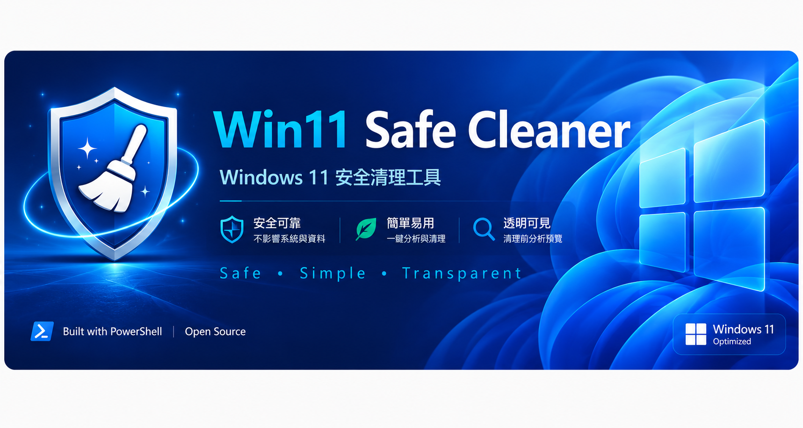
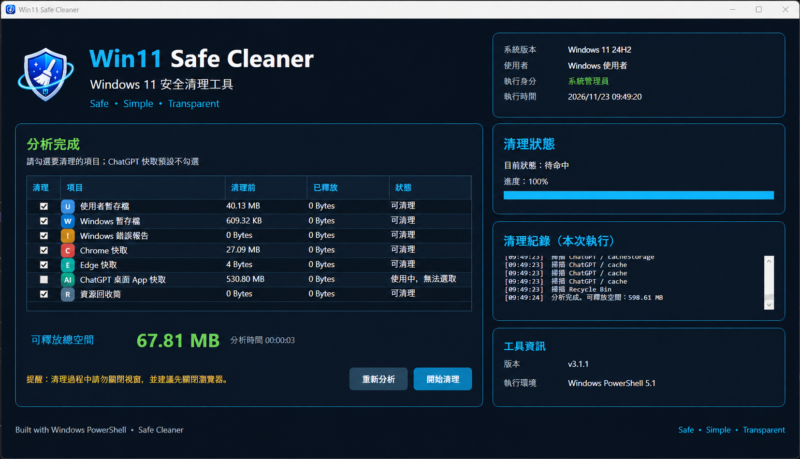

<p align="center">
  
</p>

<h1 align="center">Win11 Safe Cleaner</h1>

<p align="center">
  專為 Windows 11 設計的安全清理工具<br>
  <strong>Safe · Simple · Transparent</strong>
</p>

<p align="center">
  
  
  
  
</p>

<p align="center">
  <a href="https://github.com/Arthur0608/Win11-Safe-Cleaner-Releases/releases/latest"><strong>⬇️ 下載最新版本</strong></a>
</p>

## 這是什麼？

Win11 Safe Cleaner 是一款 Windows 11 圖形化安全清理工具。它會先分析各項快取與暫存檔、顯示預估可釋放空間，再由使用者勾選要清理的項目。

工具採用 Windows 11 Fluent Design 深色介面，以 Windows PowerShell 5.1 執行，不需要安裝 PowerShell 7 或任何第三方 PowerShell Module。

## 介面預覽

<p align="center">
  
</p>

> 預覽畫面中的使用者名稱與系統版本已使用示意資訊，以保護個人隱私。

## 可以清理什麼？

| 清理項目 | 說明 |
| --- | --- |
| 使用者暫存檔 | 清理目前使用者的暫存資料 |
| Windows 暫存檔 | 清理系統暫存資料，需要系統管理員權限 |
| Windows 錯誤報告 | 清理 Windows Error Reporting 暫存檔 |
| Chrome 快取 | 僅清除瀏覽器快取，不清除帳號與個人資料 |
| Edge 快取 | 僅清除瀏覽器快取，不清除帳號與個人資料 |
| ChatGPT 桌面 App 快取 | 可選擇清理 App 快取，預設不勾選 |
| 資源回收筒 | 清空目前資源回收筒內容 |

## v3.1.1 特色

- Windows 11 Fluent Design 圖形化介面
- 清理前先分析容量，清楚顯示每個項目的狀態
- 所有清理項目皆可個別勾選
- 可釋放空間會依勾選項目即時更新
- 清理前顯示確認視窗與項目清單
- ChatGPT 快取預設不勾選，並提供圖片預覽風險提醒
- 清理完成後只顯示本次選取的項目與實際釋放空間
- 自動要求系統管理員權限，優先使用 Windows Terminal 啟動
- 提供執行記錄，方便確認分析與清理結果

## 安全原則

Win11 Safe Cleaner 的目標不是「清得最多」，而是讓每一次清理都安全、清楚、可預期。

本工具不會清理：

- Registry（登錄檔）
- Prefetch
- Windows Update 系統元件
- Downloads、Documents、圖片、影片等使用者檔案
- 瀏覽器 Cookie、密碼、書籤、瀏覽紀錄、自動填寫與登入狀態
- ChatGPT 對話、帳號資料或已儲存的圖片

## 使用方式

1. 前往 [Releases](https://github.com/Arthur0608/Win11-Safe-Cleaner-Releases/releases/latest) 下載最新版 ZIP。
2. 將 ZIP 完整解壓縮到任意資料夾。
3. 雙擊 `Win11-Safe-Cleaner.bat`。
4. 在 Windows UAC 視窗選擇「是」。
5. 等待分析完成，勾選要清理的項目。
6. 確認項目後按下「開始清理」。

> 請勿直接在 ZIP 內執行。程式與 `Modules`、`assets`、`config.json` 必須保持在同一個解壓縮資料夾中。

## ChatGPT 快取注意事項

ChatGPT 桌面 App 快取預設為不勾選。清理前建議先關閉 ChatGPT App；清理後，尚未永久儲存的圖片預覽可能需要重新載入或重新上傳。

工具只會清理已確認的快取路徑，不會刪除 ChatGPT 對話、登入資訊或帳號內容。

## 系統需求

- Windows 11
- Windows PowerShell 5.1（Windows 內建）
- 建議使用系統管理員權限執行
- Windows Terminal 為建議選項，但不是必要條件

## 下載安全性

每個版本的 Release 都會提供 ZIP 與 SHA-256。SHA-256 可用來確認下載檔案是否完整、是否與發布者提供的檔案一致。

在 PowerShell 執行：

```powershell
Get-FileHash ".\Win11-Safe-Cleaner-v3.1.1.zip" -Algorithm SHA256
```

再將結果與該版本 Release Notes 內公布的 SHA-256 比對即可。

## 問題回報

若遇到啟動、分析或清理問題，請在本 Repository 的 [Issues](https://github.com/Arthur0608/Win11-Safe-Cleaner-Releases/issues) 回報，並附上 Windows 版本、操作步驟與畫面截圖。

---

<p align="center">
  <strong>Win11 Safe Cleaner</strong><br>
  Safe · Simple · Transparent
</p>
